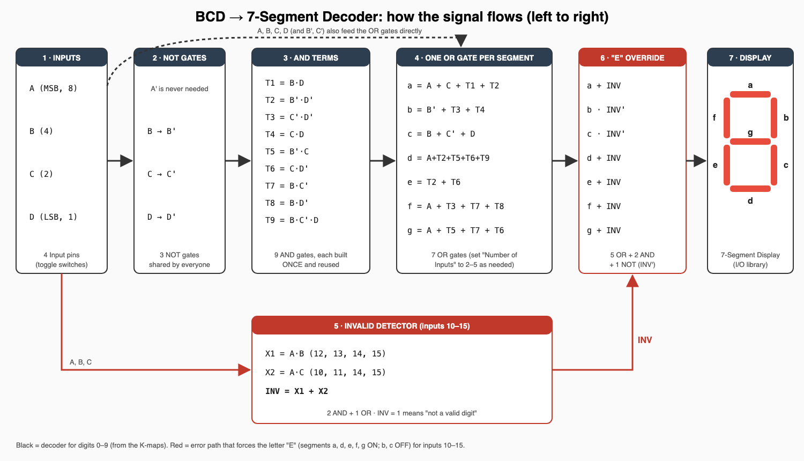

# Nelson: Your Part of the BCD Decoder

**You own:** the Logisim circuit, the "E" error detector, and testing all 16 inputs.
**Due:** circuit finished by **2:30 PM**, error detector and tests by **3:30 PM**. Joseph builds the presentation website and docs in parallel.



The signal moves **left to right** through 7 stages. Build them in that order.

---

## Terms you need to know

| Term | Meaning |
|---|---|
| **BCD** | Binary-Coded Decimal. 4 bits represent one decimal digit, 0–9 (0000–1001). |
| **A, B, C, D** | The 4 input bits. **A** is the MSB (worth 8), **D** is the LSB (worth 1). Example: 0110 = 6. |
| **MSB / LSB** | Most / Least Significant Bit. |
| **Segments a–g** | The 7 bars of the display (see the diagram). 1 = on. |
| **X'** (prime) | NOT X. B' means "B is 0". |
| **·** and **+** | AND and OR. `B·D` = B AND D. `A + C` = A OR C. |
| **Product term** | An AND of some inputs, e.g. `B'·D'`. |
| **SOP** | Sum of Products: an OR of product terms. Every segment expression is an SOP. |
| **Truth table** | Every input combination with its outputs. 16 rows here. |
| **K-map** | Karnaugh map. A grid of the truth table where grouping adjacent 1s gives a shorter expression. |
| **Don't care (X)** | An output we don't care about (inputs 10–15 are not valid digits), so the K-map can use it as a 1 or 0, whichever gives bigger groups. |
| **INVALID (INV)** | Our detector signal. It is 1 when the input is 10–15. |
| **Override** | Forcing the outputs to show "E" when INV = 1, whatever the decoder says. |

---

## Step by step

### Step 1: Set up Logisim-evolution
1. Open a new project and save it as `bcd-7seg-decoder.circ` in the project folder.
2. **Rule:** gates only. Do NOT use the "Hex Digit Display" or any decoder chip; that loses the points. The plain **7-Segment Display** (Input/Output library) is allowed. It only lights what you send it.

### Step 2: Inputs
Place 4 **Input pins** and label them `A`, `B`, `C`, `D` (top to bottom, A first).

### Step 3: NOT gates (3)
Make `B'`, `C'`, `D'`. You never need `A'`.
Tip: run each input and its inverted copy as long vertical wires (8 "rails"). Every gate then just taps the rail it needs.

### Step 4: AND terms (9)
Build each one **once** and reuse it for every segment that needs it.

| Name | Gate | Used by segments |
|---|---|---|
| T1 | B·D | a |
| T2 | B'·D' | a, d, e |
| T3 | C'·D' | b, f |
| T4 | C·D | b |
| T5 | B'·C | d, g |
| T6 | C·D' | d, e, g |
| T7 | B·C' | f, g |
| T8 | B·D' | f |
| T9 | B·C'·D (3 inputs) | d |

### Step 5: OR gates, one per segment (7)
In each OR gate's properties, set **Number of Inputs** to match.

| Segment | Expression | OR inputs |
|---|---|---|
| a | A + C + T1 + T2 | 4 |
| b | B' + T3 + T4 | 3 |
| c | B + C' + D | 3 |
| d | A + T2 + T5 + T6 + T9 | 5 |
| e | T2 + T6 | 2 |
| f | A + T3 + T7 + T8 | 4 |
| g | A + T5 + T7 + T6 | 4 |

**Checkpoint:** before going on, wire these straight to the display and test 0–9. If every digit is right, the decoder is done.

### Step 6: INVALID detector (2 AND + 1 OR)
```
X1  = A·B        → catches 12, 13, 14, 15
X2  = A·C        → catches 10, 11, 14, 15
INV = X1 + X2    → 1 for any input 10–15
```
Why this works: valid digits only go up to 1001. Anything with A = 1 **and** another 1 in B or C is 10 or more.

### Step 7: "E" override (5 OR + 2 AND + 1 NOT)
The letter **E** = segments **a, d, e, f, g ON** and **b, c OFF**.
- Segments a, d, e, f, g: `final = segment + INV` (OR forces it ON)
- Segments b, c: `final = segment · INV'` (AND with NOT INV forces it OFF)

When INV = 0, every segment passes through unchanged, so digits 0–9 still work.

### Step 8: Display
Connect the 7 final signals to the 7-Segment Display pins a–g. Hover over each pin in Logisim to confirm which is which before you wire it.

---

## Gate count (for the efficiency slide)

| Part | NOT | AND | OR | Total |
|---|---|---|---|---|
| Decoder (Steps 3–5) | 3 | 9 | 7 | **19** |
| Detector (Step 6) | 0 | 2 | 1 | **3** |
| Override (Step 7) | 1 | 2 | 5 | **8** |
| **Whole circuit** | 4 | 13 | 13 | **30** |

Count your real circuit and tell Joseph if your number differs.

---

## Test table: check all 16

1 = segment on. Tick each row once your circuit matches it.

| # | ABCD | a | b | c | d | e | f | g | Shows | ✓ |
|---|---|---|---|---|---|---|---|---|---|---|
| 0 | 0000 | 1 | 1 | 1 | 1 | 1 | 1 | 0 | 0 | |
| 1 | 0001 | 0 | 1 | 1 | 0 | 0 | 0 | 0 | 1 | |
| 2 | 0010 | 1 | 1 | 0 | 1 | 1 | 0 | 1 | 2 | |
| 3 | 0011 | 1 | 1 | 1 | 1 | 0 | 0 | 1 | 3 | |
| 4 | 0100 | 0 | 1 | 1 | 0 | 0 | 1 | 1 | 4 | |
| 5 | 0101 | 1 | 0 | 1 | 1 | 0 | 1 | 1 | 5 | |
| 6 | 0110 | 1 | 0 | 1 | 1 | 1 | 1 | 1 | 6 | |
| 7 | 0111 | 1 | 1 | 1 | 0 | 0 | 0 | 0 | 7 | |
| 8 | 1000 | 1 | 1 | 1 | 1 | 1 | 1 | 1 | 8 | |
| 9 | 1001 | 1 | 1 | 1 | 1 | 0 | 1 | 1 | 9 | |
| 10–15 | 1010–1111 | 1 | 0 | 0 | 1 | 1 | 1 | 1 | **E** | |

---

## Be ready to answer in the defense

- **"What happens with 1100?"** Without the override, the K-map expressions light a b c d f g, which looks like a **9**. That's because 1100 was a don't-care. With the detector, INV = 1 and the display shows **E**.
- **"Why don't-cares?"** Inputs 10–15 never happen in valid BCD, so we let the K-map treat them as 1s. That makes bigger groups and fewer gates.
- **"Why build each AND term once?"** Segments share terms (T2 is used 3 times). Building it once means fewer gates.
- **"Why is INV = AB + AC?"** See Step 6.

---

## Checklist

- [ ] Inputs + NOT gates
- [ ] 9 AND terms
- [ ] 7 OR gates → digits 0–9 correct (checkpoint)
- [ ] INVALID detector
- [ ] "E" override
- [ ] All 16 test rows ticked
- [ ] Gate count confirmed and sent to Joseph
- [ ] `.circ` file saved and sent to Joseph for the repo
- [ ] Screenshots sent to Joseph for the website: full circuit, plus the display showing 0, 5, 8 and E (1100)
